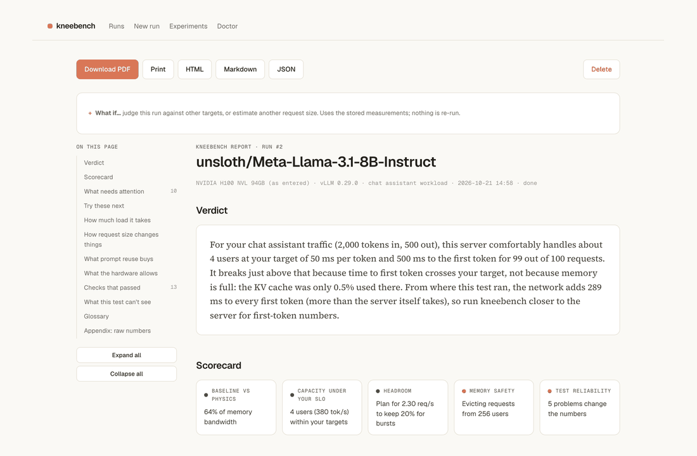
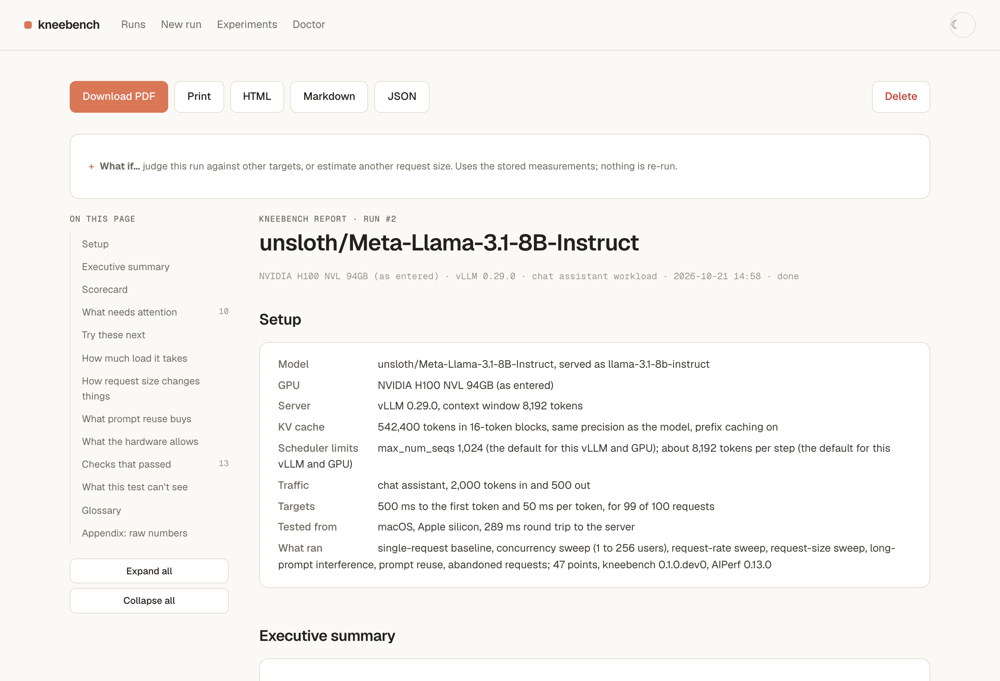
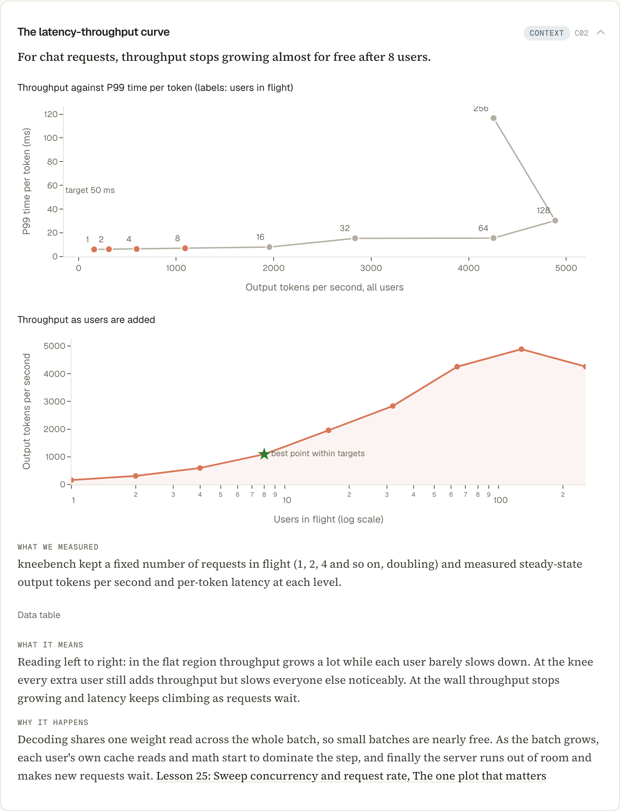
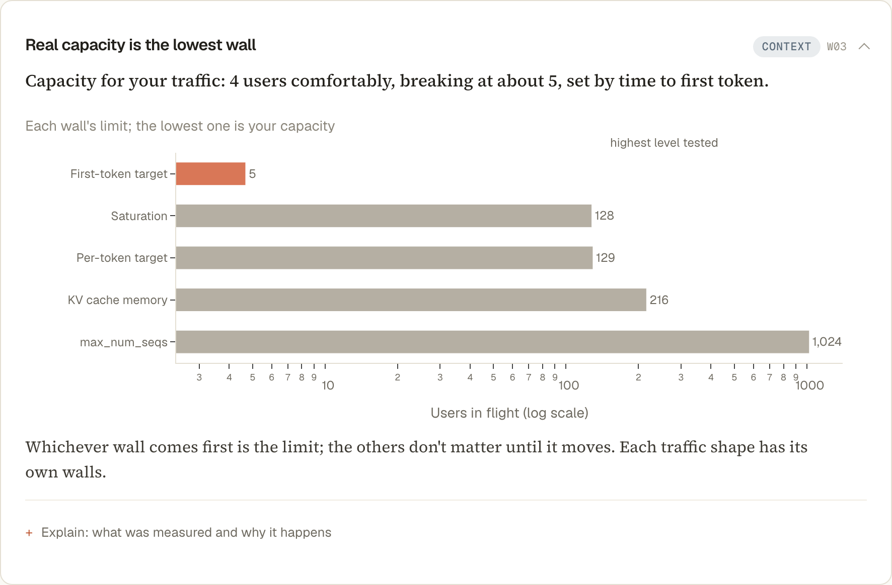
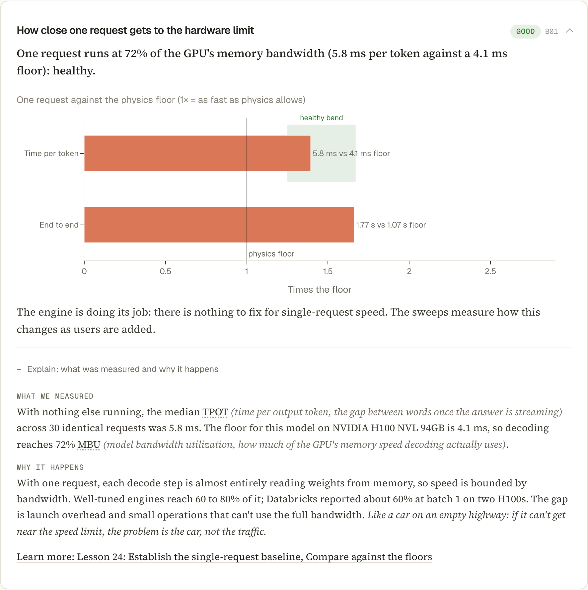
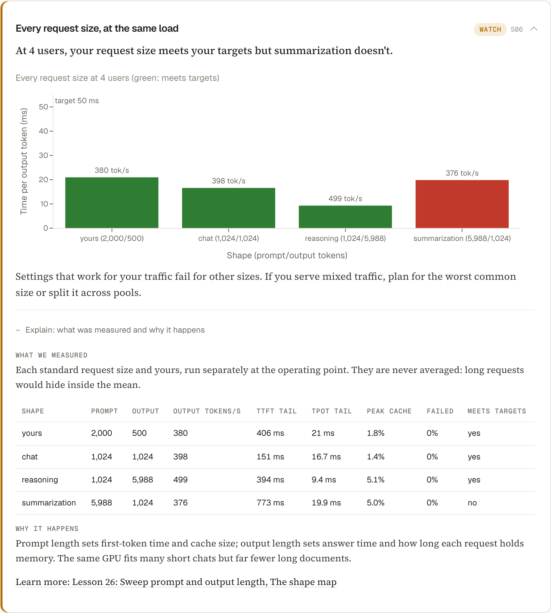
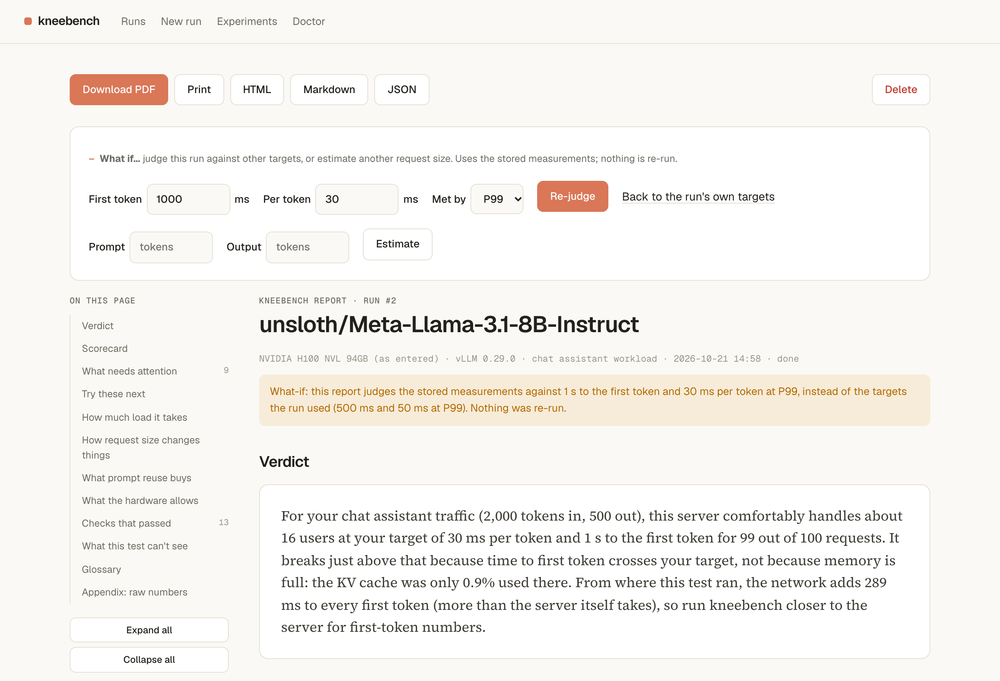
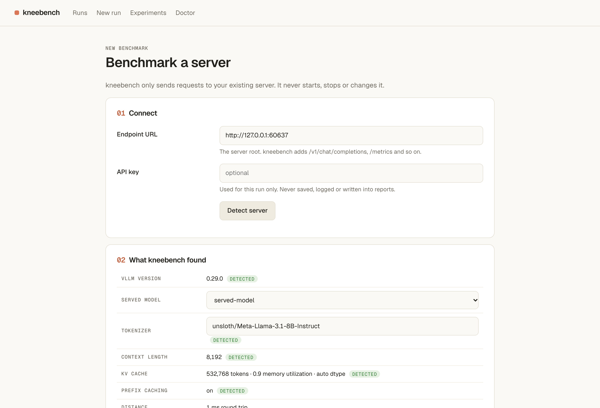
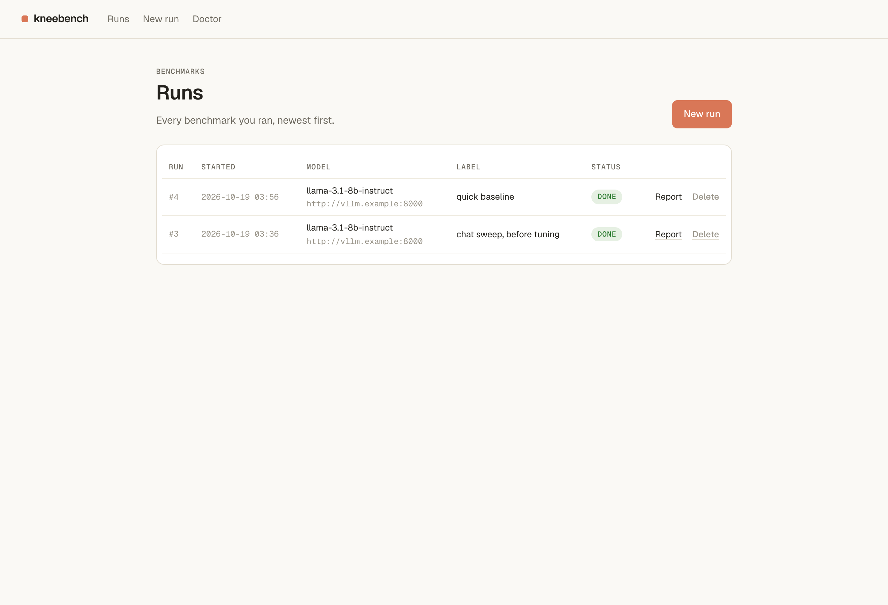

<h1 align="center">kneebench</h1>

<p align="center">
  <b>Point it at your vLLM server. Learn how many users it can really serve, where it breaks, why, and which flag to change next.</b><br>
  Benchmarks measured against physics, explained in plain words, with your own numbers.
</p>

<p align="center">
  <a href="https://github.com/S1LV3RJ1NX/kneebench/actions/workflows/ci.yml"></a>
  <a href="LICENSE"></a>
  
  
  
  <a href="https://github.com/ai-dynamo/aiperf"></a>
  
  <a href="https://buymeacoffee.com/prathams"></a>
</p>

<p align="center">
  
</p>

---

## Why this exists

Your team deployed a model on a GPU. Someone asks: "How many users can it take?" You run a benchmark and get a wall of numbers: TTFT P99, ITL, tokens per second at twelve concurrency levels. Which one is the answer? Is 6 ms per token good for this GPU? Did the server run out of memory, or just get slow?

Benchmark tools measure well. They don't explain. kneebench runs the measurements that matter, checks them against what the hardware can physically do, and writes the conclusion in plain words with your own numbers. A real verdict from a Llama 3.1 8B server on one H100 NVL:

> For your chat assistant traffic (1,024 tokens in, 1,024 out), this server comfortably handles about 8 users at your target of 50 ms per token and 500 ms to the first token for 99 out of 100 requests. It breaks at about 11 because time to first token crosses your target, not because memory is full: the KV cache was only 2.9% used there.

Every finding says what was measured, what it means, why it happens (with a link to a short lesson) and what to try next. You change your server, rerun, and compare.

## Screenshots

<table>
  <tr>
    <td width="50%"><a href="docs/images/report.png"></a><br><sub><b>Verdict first.</b> Capacity in your users and your targets, with a traffic-light scorecard.</sub></td>
    <td width="50%"><a href="docs/images/report-curve.png"></a><br><sub><b>The one plot that matters.</b> Throughput against tail latency, and the best point under your target.</sub></td>
  </tr>
  <tr>
    <td><a href="docs/images/report-walls.png"></a><br><sub><b>Three walls.</b> Saturation, your latency target and memory; the lowest one is your capacity.</sub></td>
    <td><a href="docs/images/report-baseline.png"></a><br><sub><b>Checked against physics.</b> How close one request gets to what the GPU allows.</sub></td>
  </tr>
  <tr>
    <td><a href="docs/images/report-shapes.png"></a><br><sub><b>A map, not one number.</b> Every request size at the same load, checked against your targets.</sub></td>
    <td><a href="docs/images/what-if.png"></a><br><sub><b>What if?</b> Move the targets and watch capacity move, from stored data with no rerun.</sub></td>
  </tr>
  <tr>
    <td><a href="docs/images/new-run.png"></a><br><sub><b>Detect, then ask.</b> vLLM version, model, context length and KV cache are read from the endpoint.</sub></td>
    <td><a href="docs/images/runs.png"></a><br><sub><b>Every run kept.</b> Reports regenerate from stored data; export to PDF, HTML, Markdown or JSON.</sub></td>
  </tr>
</table>

## Quickstart (macOS or Linux)

```bash
git clone https://github.com/S1LV3RJ1NX/kneebench && cd kneebench
uv sync                           # installs kneebench and its bundled AIPerf
uv run kneebench                  # opens the web UI at http://127.0.0.1:8765
```

The first start opens on a **demo run**: a real benchmark of Llama 3.1 8B on one H100, every phase, so you can explore a full report before benchmarking your own server. Delete it any time; `kneebench demo` brings it back (set `KNEEBENCH_NO_DEMO=1` to skip it).

Need uv? `curl -LsSf https://astral.sh/uv/install.sh | sh`. Gated models (such as Llama) need `HF_TOKEN` so kneebench can download the tokenizer.

Prefer the terminal? Everything in the UI is also a command:

```bash
uv run kneebench doctor --url http://your-vllm-host:8000      # check the setup, with fixes
uv run kneebench run --url http://your-vllm-host:8000 --gpu h100-sxm   # see `kneebench gpus`
uv run kneebench report 1 --format pdf                         # or md, json, html
uv run kneebench run ... --shapes 2000/500                     # your typical request size
uv run kneebench report 1 --slo-tpot-ms 30                     # what-if: other targets, no rerun
uv run kneebench compare 1 2                                   # before and after a change
```

If your server needs a key, set `KNEEBENCH_API_KEY` (the CLI) or paste it into the form (the UI); it is never saved. Entered the wrong GPU? `kneebench report <run-id> --gpu <id>`, or **Correct GPU** in the report, recomputes everything from stored data with no rerun. PDF export downloads a headless Chromium once: `kneebench doctor --install-pdf`.

Once released, `uv tool install kneebench` (or `pip install kneebench`) will work too. The install is large (about 800 MB) because AIPerf brings `transformers`, `pandas` and friends.

## Where to run it

kneebench only sends HTTP requests, so it runs anywhere: a laptop, a Linux box or a pod. **Where** it runs changes the numbers:

- **Close to the server** (same cluster or region) gives numbers you can act on.
- **Across the internet** adds network time to every first token, and a slow client can become the bottleneck. kneebench measures the distance on every run (TCP connect, TLS handshake, a plain `/health` round trip), judges first-token targets on the server's side of the network, and warns when the network dominates.

kneebench never starts, stops or reconfigures your server. It only benchmarks an existing OpenAI-compatible endpoint, one run at a time.

## What it measures

| Phase | Question it answers | Status |
|---|---|---|
| 0. Theory | What is the fastest this model can possibly run on this GPU? How many requests fit in memory? | Available |
| 1. Single-request baseline | With the GPU idle, how close to that limit do you get? | Available |
| 2. Concurrency sweep | How do throughput and per-user speed trade off from 1 to hundreds of users? | Available |
| 3. Request-rate sweep | What happens when users arrive at random, including in bursts? | Available |
| 4. Shape sweep | How do prompt length and answer length change everything? Does every request size meet your targets at the same load? | Available |
| 5. Long-prompt interference | Do long prompts freeze other users' streaming answers? | Available |
| 6. Prompt reuse | What do a shared system prompt and multi-turn history save, and how many prompt variants fit in the cache? | Available |
| 7. Three walls | Where does it saturate, miss your latency target, or run out of memory? | Available |

Every run also checks that the test itself is trustworthy: steady state reached (throughput counts only the window at full load), client not the bottleneck, outputs really as long as requested, tails and not just medians, errors counted as failures, gateways not limiting load, versions recorded.

## How to read the report

Diagnosis first, evidence second, next steps last: a short verdict, a traffic-light scorecard, the findings that need attention, a ranked "try these next" list with copy-ready flags for your vLLM version, then the curve and the walls. Each finding says what was measured, what it means, why it happens (with a link to the lesson it comes from) and what to do. Problems open by default; background findings collapse to one line; healthy checks fold into a single list. The order follows your product type: a chat team sees time to first token first, a reasoning team sees memory first.

Exports are built for people and for LLMs: the PDF keeps real text, puts a data table next to every chart, ends with every raw number, and embeds the Markdown and JSON reports as attachments.

## Limitations

- **Endpoint only.** No GPU telemetry; memory and queue findings come from vLLM's `/metrics`. If your gateway hides `/metrics`, those findings are marked as not visible.
- **Synthetic prompts.** Random prompts never share a prefix, so prefix caching can't help them. Real chat traffic often does better on time to first token.
- **Client location matters.** See [Where to run it](#where-to-run-it).
- **No Windows.** macOS and Linux only (WSL2 works).
- **vLLM first.** Other OpenAI-compatible servers work with reduced findings; SGLang support is on the roadmap.

## Roadmap

- [x] **M0 Skeleton:** packaging with bundled, pinned AIPerf; `kneebench doctor`; CI.
- [x] **M1 Detect, theory and baseline:** auto-detection, physics floors, SQLite, single-request baseline, Markdown report.
- [x] **M2 MVP:** concurrency sweep, the three walls, web UI, full report with charts and PDF export.
- [x] **M3 Rate sweep:** Poisson and bursty arrivals.
- [x] **M4 Shape sweep:** prompt and output length, your own request size, the shape map.
- [x] **M5 What-ifs and compare:** move the SLO and watch capacity move; estimate other request sizes; before and after runs.
- [ ] **M6 Release:** v0.1.0 on PyPI.
- [ ] **Later:** MoE and MLA physics, GuideLLM backend, SGLang servers, optional friendlier wording layer.

## Credits

- [NVIDIA AIPerf](https://github.com/ai-dynamo/aiperf) (Apache-2.0) generates the load. kneebench bundles a pinned version.
- The analysis follows the [Inference Engineering notes](https://github.com/S1LV3RJ1NX/inference-engineering-notes), lessons 24 to 27.
- [GuideLLM](https://github.com/vllm-project/guidellm) (Apache-2.0) provides the mock server used in integration tests.
- [Geist](https://github.com/vercel/geist-font) and [Source Serif 4](https://github.com/adobe-fonts/source-serif) (SIL Open Font License) set the UI and reports.

If kneebench saved you a day of squinting at benchmark tables, you can [buy me a coffee](https://buymeacoffee.com/prathams).

## License

MIT. See [LICENSE](LICENSE). Screenshots are regenerated with `scripts/make_screenshots.py`.
